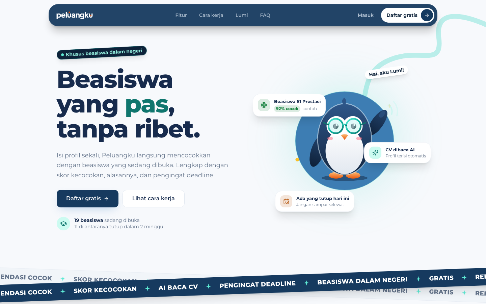
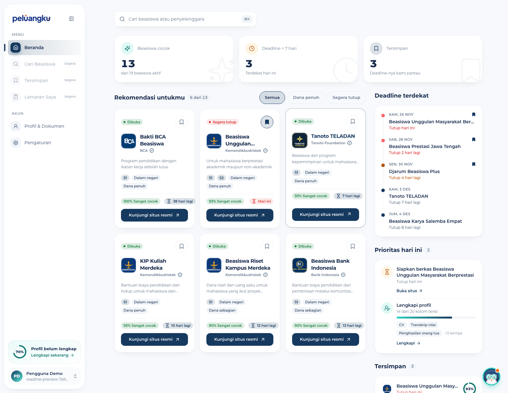

<p align="center">
  <picture>
    <source media="(prefers-color-scheme: dark)" srcset="./docs/images/logo-white.svg">
    
  </picture>
</p>

<h1 align="center">Beasiswa yang pas, tanpa ribet.</h1>

<p align="center">
  Platform rekomendasi beasiswa dalam negeri yang membantu mahasiswa menemukan peluang sesuai profil, memahami kecocokannya, dan memantau tenggat pendaftaran.
</p>

<p align="center">
  <a href="https://github.com/DoniiAdityaa/peluangku/actions/workflows/tests.yml?query=branch%3Atesting"></a>
  
  
  
</p>

<p align="center">
  <a href="#tentang-proyek">Tentang</a> ·
  <a href="#tampilan-aplikasi">Screenshot</a> ·
  <a href="#fitur-utama">Fitur</a> ·
  <a href="#kenalan-dengan-lumi">Lumi</a> ·
  <a href="#menjalankan-proyek">Instalasi</a> ·
  <a href="#pengujian-dan-kualitas-kode">Pengujian</a>
</p>

## Tentang proyek

Informasi beasiswa sering tersebar di banyak situs, dengan persyaratan dan jadwal yang berbeda. Peluangku menyatukan proses pencarian awal dalam satu dashboard: pengguna melengkapi profil, melihat rekomendasi beserta alasannya, lalu menyimpan beasiswa yang ingin diprioritaskan.

Peluangku berfokus pada **beasiswa untuk studi di Indonesia**. Pendaftaran tetap dilakukan melalui situs resmi penyelenggara, bukan melalui Peluangku.

> **Status proyek:** prototipe dalam pengembangan aktif. Dashboard rekomendasi, pengelolaan profil, dokumen, dan beasiswa tersimpan sudah tersedia. Pembacaan CV berbasis AI masih berupa simulasi; percakapan dengan Lumi dan pengiriman notifikasi belum aktif.

Dokumentasi dan screenshot ini mengacu pada versi pengembangan di branch [`testing`](https://github.com/DoniiAdityaa/peluangku/tree/testing), bukan rilis produksi di `main`. Panduan instalasi di bawah mengambil kode dari branch tersebut.

## Tampilan aplikasi

### Halaman utama

Pengenalan produk, fitur, cara kerja, serta Lumi sebagai identitas visual Peluangku.



### Dashboard rekomendasi

Ringkasan kecocokan, kartu beasiswa, filter, deadline terdekat, dan prioritas pengguna.



<sub>Screenshot menggunakan akun demo dan data contoh. Nama program, persyaratan, skor, serta tanggal yang terlihat bukan informasi pendaftaran resmi.</sub>

## Fitur utama

| Fitur                    | Yang dapat dilakukan                                                                                                    |
| ------------------------ | ----------------------------------------------------------------------------------------------------------------------- |
| **Rekomendasi personal** | Melihat beasiswa yang sesuai profil, lengkap dengan skor dan alasan kecocokan.                                          |
| **Dashboard beasiswa**   | Memeriksa ringkasan beasiswa, mencari pada daftar rekomendasi, dan memfilter pendanaan atau beasiswa yang segera tutup. |
| **Beasiswa tersimpan**   | Menyimpan dan membatalkan simpan beasiswa incaran langsung dari kartu rekomendasi.                                      |
| **Pemantauan deadline**  | Melihat sisa waktu pendaftaran, linimasa tenggat terdekat, dan prioritas harian di dashboard.                           |
| **Onboarding fleksibel** | Mengisi profil secara manual atau mencoba alur impor CV demo; onboarding dapat dilewati dan dilanjutkan nanti.          |
| **Profil dan dokumen**   | Mengelola data pendidikan, minat, preferensi beasiswa, CV, transkrip, dan maksimal tiga sertifikat.                     |
| **Akun dan keamanan**    | Registrasi, login, verifikasi email, pemulihan kata sandi, autentikasi dua faktor, dan passkey.                         |
| **Antarmuka responsif**  | Menggunakan aplikasi di desktop maupun perangkat seluler, dengan dukungan tema terang dan gelap.                        |

Dokumen pengguna disimpan pada penyimpanan privat. Akses file sertifikat dibatasi ke pemiliknya. Pemantauan deadline saat ini tersedia **di dalam dashboard**, bukan berupa pengingat otomatis melalui email atau push notification.

### Cara kerja rekomendasi

1. Pengguna mengisi pendidikan, bidang minat, IPK, domisili, dan preferensi pendanaan.
2. Sistem membandingkan profil tersebut dengan beasiswa yang masih dibuka.
3. Dashboard menampilkan rekomendasi berdasarkan skor kecocokan, beserta alasan yang dapat ditinjau pengguna.
4. Pengguna menyimpan beasiswa incaran dan melanjutkan pendaftaran di situs resmi penyelenggara.

Pencocokan saat ini menggunakan **aturan berbobot**, bukan model AI: jenjang tujuan (30%), bidang minat dibanding kategori jurusan (25%), IPK (20%), pendanaan (15%), dan wilayah (10%). Ketidakcocokan pada syarat jenjang, wilayah, atau IPK minimum membatasi skor di bawah ambang rekomendasi.

**Skor kecocokan bukan probabilitas kelulusan dan bukan jaminan memenuhi seluruh ketentuan penyelenggara.** Pengguna tetap perlu memeriksa persyaratan resmi.

## Kenalan dengan Lumi

<p align="center">
  
</p>

**Lumi** adalah maskot penguin berkacamata yang menemani pengalaman pengguna Peluangku. Karakternya dirancang ramah dan suportif, terutama saat pengguna memulai akun, melengkapi profil, atau belum menemukan hasil yang sesuai.

- **Menyapa** di landing page dan halaman autentikasi.
- **Memberi konteks visual** pada verifikasi email, keamanan akun, hasil kosong, dan halaman error.
- **Bergerak lewat SVG animasi** tanpa pemutar tambahan, dengan dukungan preferensi pengurangan gerakan (_reduced motion_).
- **Menjadi wajah asisten Peluangku**; panel pengenalannya sudah tersedia, sedangkan percakapan AI masih direncanakan.

## Teknologi

| Bagian                 | Teknologi                                                                            |
| ---------------------- | ------------------------------------------------------------------------------------ |
| Backend                | Laravel 13, PHP, Laravel Fortify                                                     |
| Frontend               | React 19, TypeScript, Inertia.js 3                                                   |
| Antarmuka              | Tailwind CSS 4, Radix UI, Lucide, SVG animasi                                        |
| Tooling frontend       | Vite+                                                                                |
| Database               | MySQL; SQLite in-memory untuk pengujian                                              |
| Pengujian dan analisis | PHPUnit/Pest, Laravel Pint, PHPStan/Larastan, TypeScript, formatter dan linter Vite+ |
| CI                     | GitHub Actions                                                                       |

## Menjalankan proyek

### Prasyarat

- **PHP 8.4.1 atau lebih baru** untuk memasang dependensi development dan menjalankan test dari lockfile saat ini. CI menggunakan PHP 8.5.
- **Composer 2**.
- **Node.js 22 LTS versi 22.18+ atau Node.js 24 LTS versi 24.11+**, beserta npm, sesuai kebutuhan Vite+.
- **MySQL 8** yang sudah berjalan.
- Ekstensi PHP yang dibutuhkan Laravel dan dependensi proyek, termasuk `pdo_mysql` untuk aplikasi serta `pdo_sqlite` untuk test.

### 1. Ambil kode proyek

Branch `testing` berisi hasil integrasi pengembangan tim.

```bash
git clone --branch testing https://github.com/DoniiAdityaa/peluangku.git
cd peluangku
cp .env.example .env
```

### 2. Siapkan database dan environment

Buat database MySQL bernama `peluangku`, lalu sesuaikan konfigurasi berikut pada `.env`:

```dotenv
APP_NAME=Peluangku
APP_URL=http://localhost:8000

DB_CONNECTION=mysql
DB_HOST=127.0.0.1
DB_PORT=3306
DB_DATABASE=peluangku
DB_USERNAME=root
DB_PASSWORD=
```

Gunakan kredensial MySQL lokal milikmu. File `.env` tidak boleh dimasukkan ke Git.

### 3. Pasang dependensi dan jalankan migrasi

```bash
composer setup
```

Perintah ini memasang dependensi PHP dan frontend, membuat application key, menjalankan migrasi, serta membangun aset frontend. Pastikan konfigurasi database sudah benar sebelum menjalankannya.

Untuk mengisi data contoh beasiswa pada lingkungan lokal:

```bash
php artisan db:seed --class=ScholarshipSeeder
```

Seeder menggunakan nama program dan tautan penyelenggara sebagai ilustrasi, tetapi **persyaratan serta deadline-nya adalah data demo**. Menjalankan ulang seeder memperbarui entri contoh tersebut. Jangan gunakan seeder ini untuk mengisi data produksi.

### 4. Jalankan aplikasi

```bash
composer dev
```

Buka **http://localhost:8000**. Daftarkan akun, verifikasi email, lalu lengkapi atau lewati onboarding untuk masuk ke dashboard.

Secara default, `.env.example` menggunakan `MAIL_MAILER=log`. Email verifikasi dan pemulihan kata sandi ditulis ke log aplikasi di `storage/logs/`, bukan dikirim ke inbox. Gunakan tautan dari log untuk pengujian lokal, atau konfigurasikan layanan email development.

Untuk membangun aset tanpa menjalankan development server:

```bash
npm run build
```

## Pengujian dan kualitas kode

Jalankan seluruh pemeriksaan yang digunakan CI:

```bash
composer ci:check
```

Atau jalankan secara terpisah:

| Perintah                     | Kegunaan                                      |
| ---------------------------- | --------------------------------------------- |
| `php artisan test --compact` | Menjalankan unit test dan feature test.       |
| `composer lint:check`        | Memeriksa format PHP dengan Laravel Pint.     |
| `composer types:check`       | Menjalankan analisis statis PHPStan/Larastan. |
| `npm run check`              | Memeriksa format dan lint frontend.           |
| `npm run types:check`        | Memeriksa tipe TypeScript.                    |

Test dikonfigurasi menggunakan SQLite in-memory melalui `phpunit.xml`. Jika PHPStan mencapai batas memori pada mesin lokal, jalankan `vendor/bin/phpstan analyse --memory-limit=1G`.

## Struktur proyek

```text
app/
├── Actions/                 # Penyimpanan profil dan dokumen
├── Http/Controllers/        # Landing, dashboard, onboarding, dan pengaturan
├── Models/                  # User, Scholarship, Certificate, dan relasinya
├── Services/                # Pencocokan beasiswa dan kontrak parser CV
└── Support/                 # Opsi formulir dan kelengkapan profil
database/                    # Migrasi, factory, dan data contoh
docs/images/                 # Screenshot, logo, dan ilustrasi dokumentasi
public/animation/            # Ilustrasi SVG Lumi
public/images/               # Identitas visual dan logo penyelenggara
resources/js/
├── components/              # Komponen UI dan maskot
├── layouts/                 # Layout aplikasi dan autentikasi
└── pages/                   # Halaman React/Inertia
routes/                      # Definisi route aplikasi
tests/                       # Unit test dan feature test
```

## Pengembangan berikutnya

- Integrasi parser CV berbasis AI untuk menggantikan `SimulatedCvParser`.
- Percakapan dengan Lumi untuk membantu memahami persyaratan dan dokumen.
- Pengiriman pengingat deadline dan ringkasan beasiswa.
- Halaman pencarian khusus, detail beasiswa, serta pelacakan lamaran.
- Pengayaan dan verifikasi data beasiswa dari sumber resmi.

## Kontribusi

Gunakan branch kerja masing-masing, lalu ajukan pull request ke **`testing`**. Pastikan pemeriksaan kualitas kode dan test lulus sebelum PR digabungkan.

Pesan commit ditulis dalam bahasa Inggris dengan format Conventional Commits, misalnya:

```text
feat(profile): add certificate uploads
fix(dashboard): correct deadline ordering
style(auth): refine login page spacing
chore(docs): update project screenshots
```

Dikembangkan bersama oleh [kontributor Peluangku](https://github.com/DoniiAdityaa/peluangku/graphs/contributors). Temuan bug dan usulan pengembangan dapat disampaikan melalui [GitHub Issues](https://github.com/DoniiAdityaa/peluangku/issues).
